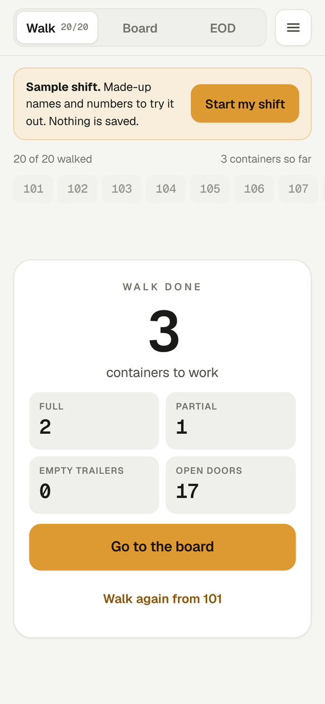
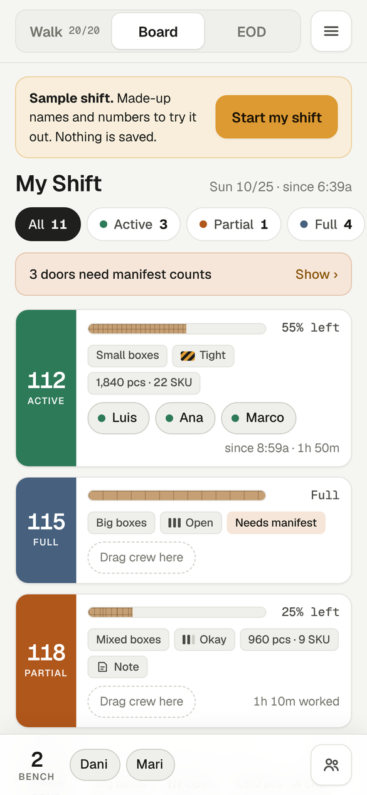
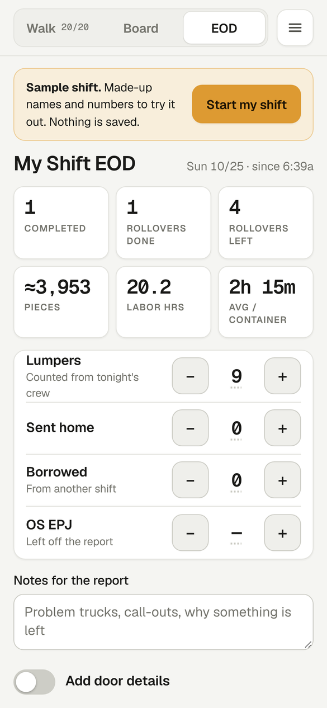

# Dock Walk

**Try it:** https://bjessief-apps.github.io/Dock-Walk/ (works best on a phone)

As a lead, the first thing I do every shift is walk the dock and check every door: what's full, what's half done, what's empty. I used to jot it all down in a notebook or in text notes on my phone. I wanted one organized place for the info I track every day, that also shows me at a glance how the shift is moving along. Dock Walk lets me tap through the doors as I walk, run the shift from one board, and build the end-of-shift report from what's already there, with almost no typing.

<table>
  <tr>
    <td align="center"> Walk the doors</td>
    <td align="center"> Run the board</td>
    <td align="center"> End-of-shift report</td>
  </tr>
</table>

Screenshots show the app's built-in sample shift with made-up names and numbers.

A phone-first board for running a dock walk: log each door's container status as you walk the doors, then track crew assignments, progress, and start and finish times through the shift.

## What it does

- **Walk:** step through your doors in order and set each container's status with taps instead of typing.
- **Board:** a clean view of the floor. Every door shows its status, how much is left, and who is on it. Drag crew between doors.
- **EOD:** builds an end-of-shift summary from the shift.
- **Settings:** your shift label, the doors on your walk, roster, and backup and restore.

## Privacy

There is no backend and no account. Everything is saved only in the browser on your device. A sample shift with made-up names shows until you start your own.
